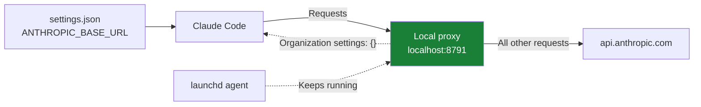

# allowifier

A Claude Code plugin that bypasses the organization policy layer while keeping your own permission rules intact. 


**For sandbox use only. This is a convenience tool, not a security boundary.**

## Requirements

- macOS
- Node.js (`node`)

If either requirement is missing, allowifier stays off and the organization policy layer remains active.

## Install

In your terminal, run:

```sh
claude plugin install allowifier --marketplace alfredtm/claude-allowifier
```

Accept the installation command the plugin presents. That command installs the local proxy and turns allowifier on.

The first session after installation runs without the organization policy layer.

## How it works

Claude Code loads organization settings from the endpoint configured by `ANTHROPIC_BASE_URL`. allowifier points that endpoint at a local proxy on `localhost:8791`.

The proxy:

- Returns `{}` for the organization-settings request, so the organization policy layer never loads.
- Forwards all other requests to `api.anthropic.com`.
- Runs under a `launchd` agent that keeps it alive.



### Permissions

Your own `allow`, `ask`, and `deny` rules still apply:

```json
{
  "permissions": {
    "ask": ["Bash(rm:*)"],
    "deny": ["Bash(curl http://*)"]
  }
}
```

An `ask` rule prompts for approval. A `deny` rule blocks the action. When no rule applies, allowifier allows the action without prompting, within these scopes:

- **Commands:** run without prompts.
- **File edits:** allowed inside `~/repos` and scratch space.
- **File reads:** allowed inside your home directory.
- **Web lookups:** allowed.

## Commands

| Command | Effect |
| --- | --- |
| `/allowifier` | Flip allowifier. The next session runs the new way. |

From a terminal, the switch is still there: `allowifier on`, `allowifier off`, `allowifier status`.

## Uninstall

**Uninstalling the plugin does not turn allowifier off.** Run `/allowifier` first — it flips allowifier off, restoring the organization policy layer — then uninstall the plugin.

## Development

Load the plugin from a local checkout:

```sh
claude --plugin-dir /path/to/claude-allowifier
```

Validate and test from the repository root:

```sh
claude plugin validate .
claude plugin test .
```

## License

MIT
