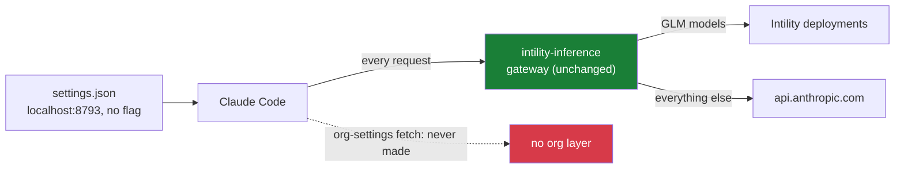

# allowifier

A Claude Code plugin that bypasses the organization policy layer while keeping your own permission rules intact. Organization-level deny rules, ask lists, and `claudeMd` content are not loaded.

**For sandbox use only. This is a convenience tool, not a security boundary.**

It runs two ways, and picks by what it finds:

- **On top of [intility-inference](../claude-intility-inference)** — its gateway keeps carrying every request (GLM beside the Claude models, deployments, keys, all of it), while the org layer stops loading. No proxy of its own.
- **On its own** — a small local proxy, and the base URL pointed at it.

## The mechanism, in one paragraph

Claude Code fetches organization settings only when its base URL is (or is declared) Anthropic's own: on a custom `ANTHROPIC_BASE_URL` *without* the internal `_CLAUDE_CODE_ASSUME_FIRST_PARTY_BASE_URL` flag, the org-settings fetch is skipped entirely — no denies, no ask lists, no injected `claudeMd`, however faithfully a gateway forwards. That flag is the whole of the org layer on a machine that runs intility-inference: the mod writes the flag beside its gateway's URL so the org layer loads, and re-adds it whenever it goes missing. allowifier composes instead of fighting: it **respells the URL** (`localhost` for `127.0.0.1` — the same listener, a spelling the gateway accepts and the inference daemon does not recognize as its own) **and takes the flag away**. The inference daemon finds a base URL that is not exactly its own, so it stands down — it never re-adds the flag — while its gateway, deployments, `/model` rows and key renewal keep working untouched beneath.



Without intility-inference the same rule applies with no gateway to lean on: allowifier keeps a local proxy on `localhost:8791` (under a `launchd` agent) and points the base URL at it. The proxy forwards to `api.anthropic.com` and answers the org-settings path with `{}` for Claude Code versions that ask the base URL for them.

## Requirements

- On top of intility-inference: nothing beyond that mod's own (node, an Intility login). Works wherever it works.
- Standalone: macOS and Node.js, for the `launchd`-kept proxy.

If the requirements are missing, allowifier stays off and the organization policy layer remains active.

## Install

```sh
claude plugin install allowifier --marketplace alfredtm/claude-allowifier
```

Accept the installation command the plugin presents. That command installs the switch and turns allowifier on.

The first session after installation runs without the organization policy layer.

## Permissions

Your own `allow`, `ask`, and `deny` rules still apply:

```json
{
  "permissions": {
    "ask": ["Bash(rm:*)"],
    "deny": ["Bash(curl http://*)"]
  }
}
```

An `ask` rule prompts for approval. A `deny` rule blocks the action. When no rule applies, allowifier allows the action without prompting, within these scopes:

- **Commands:** run without prompts.
- **File edits:** allowed inside `~/repos` and scratch space.
- **File reads:** allowed inside your home directory.
- **Web lookups:** allowed.

## Commands

| Command | Effect |
| --- | --- |
| `/allowifier` | Flip allowifier — on if it was off, off if it was on. |
| `/allowifier on` / `/allowifier off` | Say which way, instead of flipping. |
| `/allowifier status` | Where things stand: the mode, the lines, the gateway. |
| `/inference on` `off` `login` `logout` `models set` | Run as they always did: allowifier steps aside first, composes back on top after. |

Every one of them lands next session — settings load at startup.

From a terminal, the switch is still there: `allowifier on`, `allowifier off`, `allowifier status`.

### What intility-inference sees

Composed, the inference daemon reports `ANTHROPIC_BASE_URL is http://localhost:8793 — not ours, left alone`, and its `ensure` declines to arm over the line each session. That is the stand-down working as intended: the gateway, the deployments, the `/model` rows and the key renewals all keep running (they happen before its env-line check), and only its management of the env line pauses. `/inference status` and `/inference add` still work; a saved model choice writes its `/model` rows only while the line is spelled its way, so follow `/inference add` with `/inference on` once — it rewrites the rows, and allowifier composes back on top by itself.

## Uninstall

**Uninstalling the plugin does not turn allowifier off.** Run `/allowifier` first — it restores intility-inference's lines whole (or removes the standalone line), so the next session loads the org settings — then uninstall the plugin.

## Notes and limits

- Not a security boundary. The composed mode relies on respelling another mod's URL so its daemon stands down; anything that rewrites the line back (`claude plugin`-driven updates of intility-inference included) simply gets composed over again at the next session.
- The compose happens only once the gateway has answered through the `localhost` spelling — proof the spelling routes before it is written. If nothing answers, nothing changes.
- Uninstalling intility-inference while composed leaves the line pointing at a gateway nothing restarts. Run `/inference off` first (the dance handles it), or `/allowifier` after.
- The flag is an internal Claude Code switch. If a release changes how org settings load, `/allowifier status` still reports the lines, but check the "Managed settings" line at startup after a Claude Code upgrade.
- Versions before 0.15.0 pointed the base URL at their own proxy unconditionally and fought intility-inference over the line — whoever armed last won, and `allowifier off` would delete the line whichever mod had written it. The first run of 0.15.0 composes instead; a leftover proxy agent from 0.14 is unloaded by `allowifier on` or `off`.

## Development

Load the plugin from a local checkout:

```sh
claude --plugin-dir /path/to/claude-allowifier
```

Validate and test from the repository root:

```sh
claude plugin validate .
claude plugin test .
```

## License

MIT
